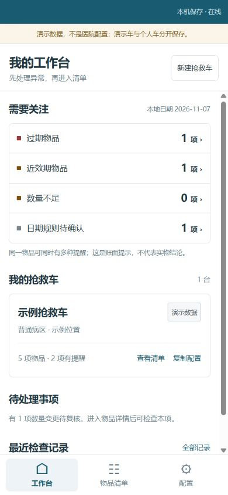
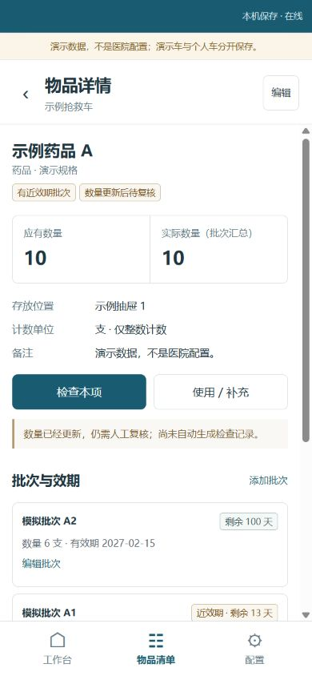

# 抢救车管理助手

护士个人使用的轻量化抢救车管理辅助工作台。围绕“找异常 → 查批次 → 逐项检查 → 使用补充 → 复核 → 备份”完成一条可操作的本地管理流程。

**Mobile-first · PWA · Local-first · Configurable**

当前交付：Working Demo，全部展示数据为模拟数据，真实用户价值与手机安装兼容性待验证。




## 先看产品

| 你想了解 | 入口 |
|---|---|
| 为什么做、解决什么问题、如何取舍 | [产品案例与决策](docs/product-case.md) |
| 五个页面怎样完成任务 | [交互流程与数据架构](docs/architecture.md) |
| 原型长什么样 | [原型截图](docs/assets/prototype-desktop.png) · [下载可点击单文件 HTML](https://raw.githubusercontent.com/miemie92312/Emergency-Cart-Management-System/main/public/prototype/index.html) |
| 实际实现了什么、边界是什么 | [当前 PRD](docs/PRD.md) |
| 如何证明功能与数据可靠 | [验证记录、依赖及许可证](docs/validation.md) |
| 14 天计划交付情况 | [范围对照与后续里程碑](docs/delivery-14-day.md) |
| 如何运行、迁移和部署 | [使用与部署说明](docs/usage.md) |
| 原始审查依据 | [审查归档](docs/reviews/README.md) |

原型链接是 HTML 源文件：保存为 `index.html` 后用浏览器打开即可点击。运行工作 Demo 后也可访问 `/prototype/`。原型仅使用内存模拟，不连接数据库；本文截图来自真正持久化的工作 Demo。

## 试用一条完整流程

1. 打开工作台，从空白创建一台车；或者进入“配置 → 体验演示数据”，明确创建独立的示例车。
2. 从“近效期”进入筛选清单，查看具体批次。只有年月的有效期显示“日期规则待确认”，不擅自补月末。
3. 逐项选择检查结果与异常，保存人、设备时间和当时快照。跳过的项目仍未检查，设备必检未完成不能整体正常。
4. 使用或补充数量，保留前后值与原因；补足后显示待复核，不自动生成正常检查。
5. 导出 XLSX 阅读，另存完整 JSON。恢复先校验、预览与确认，再在同一事务覆盖；失败不破坏原数据。

## 当前能力

- 多车创建、切换、编辑、配置复制和可恢复归档；复制不带实际库存与检查。
- 药品、医用耗材、器械设备、其他物品；七种空科室入口与用户配置模板。
- 批次管理、日精度效期提醒、数量不足；未知数量与零区分，应有量与旧最低阈值区分。
- 单项检查、多异常、设备自定义必检、完整历史、使用补充与数量变化。
- 四种简单扩展字段：文本、数字、日期、备注。
- 本地 IndexedDB、Zod 校验、事务提交后提示、跨窗口覆盖保护。
- 完整 JSON v2、旧版 v1.0 兼容、覆盖前快照回退；真正的四 Sheet XLSX 导出。
- PWA 清单、图标、离线资源缓存与主动更新提示；保留旧版只读与备份入口。

不引入业务后端、登录、云同步、多人协同、二维码或 AI。数量第一版只支持离散整数。模板不预填未经医院确认的药品、规格及数量。它是个人辅助工具；本轮只模拟未来流程，**真实替代正式检查/交接记录须另行确认**。

## 本地运行

需要 Node.js 24+。在项目目录执行：

```powershell
npm ci
npm run dev
```

打开终端显示的本地地址。开发模式不启用 Service Worker。验证生产版：

```powershell
npm test
npm run build
node scripts/serve.mjs
```

打开 `http://127.0.0.1:4173`，也可双击根目录“打开产品.cmd”（先构建）。本地静态服务仅提供文件，没有业务 API。模块版工作 Demo 不能直接双击根 `index.html` 运行；无数据库低保真原型可以。

手机安装需要 HTTPS 静态部署；Android 与 iOS 的安装方式和实际测试边界见[使用说明](docs/usage.md)。已提供手动 GitHub Pages 工作流，尚未把未部署的 URL 当作公开 Demo。

## 关键设计

**先修数据，再扩功能。** 从单文件原生项目增量演进，先修复旧版恢复先删后写、请求成功误当事务完成、批量记录语义与导入 ID 风险，再引入模型和页面。当前仍为原生 JavaScript 模块，Vite 负责构建，未为了技术栈迁移而重写 Vue。

**库存只有一个来源。** 在车物品与批次分离；批次模式的实际数由批次汇总，不能再编辑另一份总数。旧最低库存阈值不直接转成医院应有量。

**不补造事实。** 旧检查结果未知；年月效期待确认；未检查不默认正常；补充不等于复核；演示车与记录持续标记来源。

**恢复失败可退回。** 新库旁路读取旧库，原库不删除；全量校验后使用单个事务恢复，保留覆盖前快照，并拒绝另一窗口旧数据覆盖。独立 JSON 文件仍是抵御浏览器清理的必要备份。

## 工程与证据

技术：原生 JavaScript、Vite、Dexie、Zod、SheetJS CE、vite-plugin-pwa。版本锁定在 `package-lock.json`，运行时第三方许可见 [THIRD_PARTY_NOTICES](public/THIRD_PARTY_NOTICES.txt)。

2026-11-07 本轮验证：

- 自动回归 **25/25 通过**；生产构建成功。
- 合成数据浏览器验证：真实 IndexedDB 故障回滚、旧库迁移、恢复回退、双窗口冲突、刷新持久化、实际 JSON/XLSX 下载回读。
- 生产缓存验证：静态服务停止后仍能刷新、写入并保留记录；更新前提示保存。390px / 320px 响应式走查。
- 生产依赖 `npm audit --omit=dev` 为 0；完整构建依赖仍有 6 项告警，详见[验证记录](docs/validation.md)。

尚未开展护士访谈、真实医院辅助试用、Android/iOS 真机安装或效果对比。**当前不是已经验证实用价值的 MVP。** “Day 1–14”用于组织计划范围；实际提交日期可追溯，不代表伪造十四天经历或临床效果。

## 项目目录

```text
src/                 模型、事务、页面、迁移与导出
styles/              手机优先布局
legacy/              旧版只读入口和原始 PWA 文件归档
public/prototype/    独立可点击低保真原型
public/icons/        自绘图标与安装资源
tests/               数据可靠性与导出回归
qa/                  开发专用合成 IndexedDB 故障页，不进入生产构建
docs/                产品案例、PRD、流程、验证、截图与审查证据
.github/workflows/   自动检查与手动 Pages 部署
```

本项目使用 AI 辅助设计与实现，产品范围决策、方案复核、测试证据与待验证假设单独记录。个人贡献应按实际参与解释；不把 AI 输出或未发生的用户研究包装为已完成个人成果。

项目自身许可证尚待仓库所有者确定；第三方依赖遵守各自许可证。
