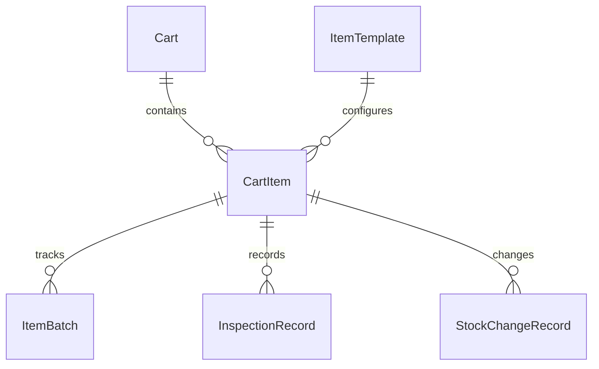
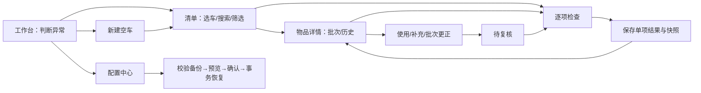

# 数据模型与实现边界

当前采用原生 JavaScript 模块 + Vite 构建，Dexie 管理 IndexedDB，Zod 在每次写入与导入前校验。保留原项目的交互基础与旧数据读取能力，没有整体迁移 Vue。未来当表单复用和状态复杂度明确阻碍迭代时，再逐页引入 Vue 3 / TypeScript / Vant。

## 模型

| 概念 / 实际表 | 关键字段与约束 |
|---|---|
| Cart / carts | id、名称、科室、位置、dataPurpose、归档时间；演示与个人配置分开 |
| ItemTemplate / templates | 当前采用车配置模板内的物品定义数组；复制定义与应有量，不复制实际库存、批次或检查；未单独建设全局物品目录 |
| CartItem / items | cartId、四类 type、名称、规格、单位、位置、requiredQuantity、quantityMode、revision；模板只提供配置起点，实际车内配置独立 |
| ItemBatch / batches | itemId、批号、quantity、expiryDate、expiryPrecision；精度为 day / month；年月不推算月末 |
| InspectionRecord / checks | 检查人、checkedAt、recordedAt、timeSource、source、result、findings、物品快照与设备确认项目；不可批量制造逐项正常 |
| StockChangeRecord / changes | 独立 id、cartId、itemId、可选 batchId、前后数量、原因、发生时间；与库存同事务保存 |
| fields / settings | 扩展字段仅 text / number / date / remark；提醒规则和备份生成时间；未做低代码编辑器 |
| legacyArchives / migrations | 原始旧 JSON 全量保留、指纹、迁移来源；不丢弃无法关联的旧检查 |
| meta | 数据 generation 与覆盖恢复前快照；不属于业务导出表 |

第一版仅支持以支、瓶、件等为单位的非负整数计数。小数扩展字段不等于支持毫升库存。批次模式的实际数量只由批次求和；空白未知与明确零分开。旧 minimumQuantity 单独保留为 legacyMinimumQuantity，不能当医院应有数量。

所有新检查使用设备时间，当前不开放手调 checkedAt；本地时间和检查人是用户填写/设备来源，未形成防篡改审计、身份认证或医院认可的签名。设备必检项目必须配置且全部确认正常，才允许整体正常；这只表示用户确认，不能验证实际设备状态。

## 页面与字段复用

`src/app.js` 以四种 type 选择有限字段片段；共用字段、数量、效期、检查与弹窗渲染。没有为每个药品建组件，也未引入通用动态公式或字段联动框架。当前类型分支仍集中在原生页面模块内；迁移 Vue 时可抽出 MedicineFields、ConsumableFields、EquipmentFields、CustomFields，不需要先做平台化架构。

## 数据路径与迁移

`表单 → 暂存视图修改 → dehydrate → Zod 关联校验 → generation 检查 → 全部相关表单一事务 → oncomplete 后刷新 UI`。失败保持旧库与表单；另一窗口已保存时拒绝旧快照覆盖。

旧库 `RescueCartDB` v1 只读访问，新库 `EmergencyCartAssistantDB` 旁路建立。旧版 v1.0 JSON（以及原始三表对象）先完整校验再转换。旧检查统一为来源未知、结果未知；不补造正常，不把旧发生时间当实际录入时间。旧年月效期原样保存，未知字段留在原始归档中。

迁移不是向现有车自动追加：用户预览后选择完整覆盖。迁入的旧车用途为 legacy_unclassified，必须人工确认配置和使用背景。原数据库保持不动；旧版入口只读并能导出原格式备份。部署更换域名、端口、浏览器或设备会改变本地存储范围，须先导出 JSON 再恢复。

新 JSON 包含 schemaVersion 2、全部业务表、条数和 SHA-256，拒绝未知版本、危险键、重复 ID、断裂引用及精度错误。校验和用于发现损坏，不能证明备份来源可信。恢复在一个事务内覆盖并保存前快照；失败回滚。前快照仍在同一浏览器，不能抵御清理站点数据，应下载外部备份。

## 目录

| 路径 | 职责 |
|---|---|
| src/domain.js | 校验、日期、备份格式、旧数据转换 |
| src/repository.js | Dexie 表、事务、版本冲突、快照恢复 |
| src/view-model.js | 规范表与页面视图适配、模拟数据 |
| src/app.js / styles/app.css | 五页业务交互与手机布局 |
| src/export.js | XLSX 与 JSON 下载 |
| src/legacy-safety.js / legacy/ | 旧格式安全读取、原生事务与只读旧版 |
| public/prototype/ | 与数据库隔离的可点击低保真原型 |
| tests/ / qa/fixtures.html | 自动回归 / 开发环境合成 IndexedDB 故障页 |
| vite.config.js / public/legacy-cache-bridge.js | PWA 构建、提示更新、限定范围旧缓存清理 |

二维码、账号、后端、同步、AI、患者信息与医院正式交接流程均不在当前实现范围。
