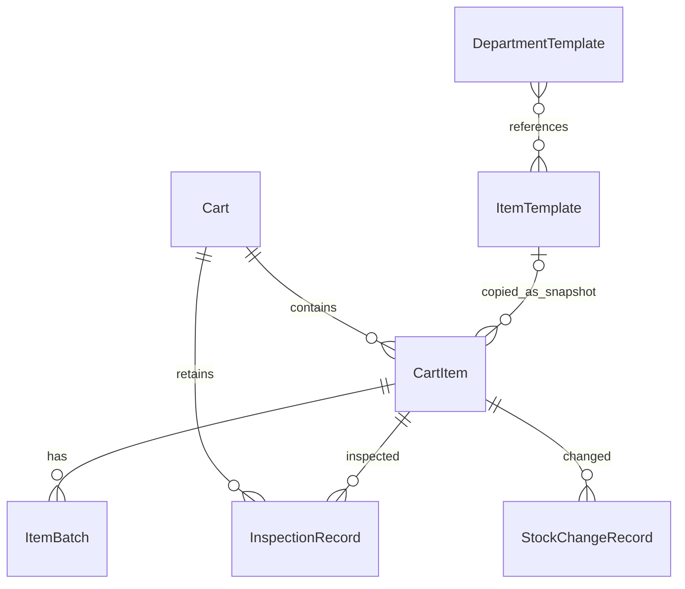

> 历史审查归档：以下为开发前的审查/方案快照，保留当时状态与候选设计。当前已交付能力、授权范围和实测结果以 [当前 PRD](../PRD.md)、[实现架构](../architecture.md)、[验证记录](../validation.md) 为准。

# 数据模型、兼容迁移与动态组件设计

日期：2026-11-07，R1 产品评审修订。状态：以下 TypeScript 是后续 M1 的数据契约示意，未写入或运行于项目；M0 继续使用原生三 Store，不提前建立新库。

关联：[当前 PRD 修订稿](./00_PRD_V0.1_修订稿R1.md)、[项目审查报告](./01_项目审查报告.md)、[实施参考](./03_分阶段实施计划.md)。当前先交付独立 Prototype，不执行这些数据模型。Demo 优先原生实现，覆盖四类固定字段区与空白科室入口；Vue 按复杂度再决定。以下组件命名是未来可选的组织方式，不是技术迁移承诺；二维码仍不在首版。

## 1. 必须先澄清的对象关系

PRD 的 Cart、ItemTemplate、ItemBatch、InspectionRecord 不足以表达“同一种物品放在不同车上，但应有数量、位置和实际批次不同”。必须加入 **CartItem**，并区分科室模板和单物品模板。



图中 DepartmentTemplate 对 ItemTemplate 是模板引用列表，数据库无需另建关系表；复制到车上后保留配置快照。历史记录不随物品归档消失。旧版孤立检查记录作为特殊历史保存，不强行满足新业务外键。

## 2. 核心数据契约

### 2.1 公共类型和字段配置

```ts
type Id = string;
type DateOnly = string;       // 严格校验 YYYY-MM-DD，真实存在的日历日期
type YearMonth = string;      // 严格校验 YYYY-MM，月份为 01–12
type ExpiryPrecision = 'day' | 'month';
type Instant = string;        // ISO 8601 时间戳，用于发生/录入时间
type ItemType = 'medicine' | 'consumable' | 'equipment' | 'custom';
type FieldValue = string | number | null;
type DataPurpose = 'demo' | 'user_configured' | 'legacy_unclassified';

interface FieldDefinition {
  id: Id;                    // 稳定字段 ID，改标签不能改 ID
  key: string;               // 受限键名，拒绝 __proto__/constructor/prototype
  label: string;
  kind: 'text' | 'number' | 'date' | 'remark';
  required: boolean;
  order: number;
  min?: number;
  max?: number;
  maxLength?: number;
  archivedAt?: Instant;
}

interface ItemDefinition {
  name: string;
  type: ItemType;
  specification?: string;
  unit?: string;
  quantityPrecision: 0;       // 首版仅离散计数，数量不接受小数，不自动取整
  tracking: { stock: boolean; batch: boolean; expiry: boolean };
  fields: FieldDefinition[];
  equipmentCheckItems?: { id: Id; label: string; required: boolean }[];
}
```

Demo 提供药品、耗材、设备、其他物品四类固定字段区；若未来迁移 Vue，再分别命名为 MedicineFields、ConsumableFields、EquipmentFields、CustomFields。自定义字段仅文本、数字、日期、备注四类，只扩展物品信息，核心数量、批次、检查字段仍有固定契约。不提供单选、多选、开关、动态公式、字段联动、拖拽、任意 JavaScript/HTML 或远程字典。FieldDefinition 只保留必要校验，不建设通用低代码引擎。

quantityPrecision 固定为 0，适用于支、瓶、件等离散计数。quantity、requiredQuantity 与旧最低库存均校验为有限非负整数；未知量另用 null。规格文本中的 ml 不代表数量单位是 ml。未来连续计量需另行确认单位与小数精度，当前不创建通用计量模型。自定义 number 字段可保存有限数值，但不能绕过核心库存的整数规则。

日期字段与时间戳分开。日精度效期用本地当前年月日对应的“日历日序号”比较；可使用校验后的年月日构造 UTC 日序号进行整数差计算，但不能把效期字符串当 UTC 时间点再转本地日期。覆盖闰年、月底、跨年和夏令时环境。年月精度只保存原值，首版统一返回 rule_pending（日期规则待确认），不补月末、不计算剩余天数、不混入正常或过期计数；此状态按数据派生，不另存一份易过期的状态。

### 2.2 Cart、DepartmentTemplate、ItemTemplate

```ts
interface Cart {
  id: Id;
  name: string;
  department: string | null;  // 迁入未知，不能猜科室
  location?: string;
  sourceDepartmentTemplateId?: Id;
  sourceTemplateVersion?: number;
  dataPurpose: DataPurpose;
  configurationStatus: 'draft' | 'user_confirmed';
  configurationConfirmedAt?: Instant;
  configurationConfirmedBy?: string; // 自报，不等于身份认证
  revision: number;
  createdAt: Instant;
  updatedAt: Instant;
  archivedAt?: Instant;
}

interface DepartmentTemplate {
  id: Id;
  name: string;
  version: number;
  itemTemplateIds: Id[];
  origin: 'built_in_blank' | 'user_created';
  dataPurpose: DataPurpose;
  createdAt: Instant;
  updatedAt: Instant;
  archivedAt?: Instant;
}

interface ItemTemplate {
  id: Id;
  version: number;
  definition: ItemDefinition;
  defaultRequiredQuantity: number | null;
  defaultLocation?: string;
  defaultCustomValues?: Record<Id, FieldValue>;
  dataPurpose: DataPurpose;
  createdAt: Instant;
  updatedAt: Instant;
  archivedAt?: Instant;
}
```

- 内置科室入口只包含名称和空列表，不内置真实药品、规格、单位及数量。
- 模板中的数量仅为用户提供的配置默认值，复制时要确认；不是实际库存。
- 更新模板生成新 version；已有车不自动套用新模板。V0.1 先采用“复制并编辑”，暂不开发批量模板升级/差异合并界面。
- `user_confirmed` 表示用户确认自己录入的配置，不等于医院审批通过。真实使用需另行确认医院授权流程。

### 2.3 CartItem：在车物品实例

```ts
type QuantitySource =
  | { mode: 'batches' } // 实际数量只由有效批次分组求和
  | { mode: 'aggregate'; actualQuantity: number | null }
  | { mode: 'none' };

interface CartItem {
  id: Id;
  cartId: Id;
  sourceItemTemplateId?: Id;
  sourceTemplateVersion?: number;
  definitionSnapshot: ItemDefinition;
  requiredQuantity: number | null;
  requiredQuantitySource: 'user_entered' | 'user_template' | 'unconfirmed';
  quantity: QuantitySource;
  quantityConfirmedAt?: Instant; // 数量录入确认时间，不代表完成实物安全检查
  legacyMinimumQuantity?: number;
  legacyMinimumQuantitySource?: 'stored_value' | 'legacy_software_default';
  location?: string;
  remark?: string;
  customValues: Record<Id, FieldValue>;
  fieldSchemaVersion: number;
  revision: number;
  createdAt: Instant;
  updatedAt: Instant;
  archivedAt?: Instant;
  legacyRef?: { migrationId: Id; store: 'drugs'; key: string | number };
}
```

**数量真源规则：**

1. 跟踪批次或效期的计数物品采用 batches，CartItem 不再保存另一份可编辑 actualQuantity。
2. 不跟踪批次/效期的计数设备或自定义物品可采用 aggregate；不创建伪造的生产批号。
3. stock=false 时采用 none，数量提醒不适用。V0.1 配置界面不开放互相矛盾的 tracking 组合。
4. 新建/复制车的实际数量默认未知，不默认等于应有数量或 0。批次模式需区分“尚未录入数量”与“已确认账面数量为零”：没有 quantityConfirmedAt 且无批次时读模型返回 unknown。旧账面数量可迁入展示，但不因此补写实物检查时间。
5. requiredQuantity=null 意味着待确认，不能算“数量正常”。旧最低库存提醒仍独立工作，并明确叫“旧最低库存提醒”。
6. 统计实际数量按已确认的同一单位求和；不把不同规格、单位合并。不把过期实物从“实物总数量”里静默扣除；需要时单列异常数量，避免暗示临床可用性判断。

### 2.4 ItemBatch：批次及同效期数量分组

```ts
interface ItemBatch {
  id: Id;
  itemId: Id;                 // 必须指向 CartItem，不是 ItemTemplate
  batchNumber?: string;       // 可未知，不凭空生成临床批号
  quantity: number;           // V0.1 计数单位下为有限非负整数
  expiryDate?: DateOnly | YearMonth;
  expiryPrecision?: ExpiryPrecision;
  openedAt?: DateOnly;
  openedExpiryDate?: DateOnly;
  remark?: string;
  revision: number;
  createdAt: Instant;
  updatedAt: Instant;
  archivedAt?: Instant;
  legacyRef?: { migrationId: Id; store: 'drugs'; key: string | number };
}
```

- 同一个生产批号可以有多个分组：部分已开启、效期或位置不同的情形不应被强制合并。
- expiryDate 与 expiryPrecision 必须同时存在或同时缺失，day 对应 YYYY-MM-DD，month 对应 YYYY-MM；运行时校验真实日历值，不靠 string 类型保证正确。
- 原有效期为合法日精度、且有经确认的开启后失效日期时，提醒使用较早日期。原效期为年月精度时整体仍为“日期规则待确认”，不把某个开启日期当作补全原效期的依据；缺失/非法值不推断临床时限。
- 部分数量开启时拆分数量，拆分前后总量守恒。完整的开启后时限规则编辑器不列为首轮必做。
- 零数量批次保留历史，不进入“当前在车批次过期”统计；物品仍可显示缺失/短缺。归档批次也不计当前数量。
- 类型不适用效期时显示“不适用”，与“应该有但未设置”分开。设备维护日期不进入药品 expiryDate。
- 输入只有“年月”的效期原样保存并标 month；V0.1 不擅自补为月末日期，不实现医院日期政策引擎。后续确实需要按规则换算时另行设计并确认来源。

### 2.5 InspectionRecord：新记录与旧历史分开表达

```ts
type Finding = 'quantity_short' | 'expired' | 'packaging_abnormal'
  | 'missing' | 'equipment_abnormal' | 'other';

interface InspectionSnapshot {
  itemName: string;
  specification?: string;
  unit?: string;
  location?: string;
  itemRevision: number;
  requiredQuantity: number | null;
  observedQuantity: number | null;
  batches: { id: Id; batchNumber?: string; quantity: number;
             expiryDate?: DateOnly | YearMonth;
             expiryPrecision?: ExpiryPrecision; openedExpiryDate?: DateOnly }[];
  fieldDefinitions?: FieldDefinition[];
}

interface NewInspectionRecord {
  id: Id;
  cartId: Id;
  itemId: Id;
  batchId?: Id;
  checker: string;
  result: 'normal' | 'abnormal';
  findings: Finding[];        // 支持同物品多个异常
  equipmentResults?: { checkItemId: Id; label: string;
                       result: 'normal' | 'abnormal' | 'not_applicable' }[];
  remark?: string;
  checkedAt: Instant;        // 设备在用户明确确认时生成；首版无手工改时/补录
  recordedAt: Instant;       // 系统本次写入时间；事务完成后才展示为已保存
  timeSource: 'device';      // 首版新记录只接受 device
  source: 'manual_item' | 'manual_batch' | 'recheck';
  confirmation: 'explicit_self_report';
  snapshot: InspectionSnapshot;
  correctsRecordId?: Id;     // 更正追加，原记录仍保留
}

interface LegacyInspectionRecord {
  id: Id;
  cartId: Id;
  itemId: Id | null;         // 原药品不存在时保留孤立历史
  checker: string | null;
  checkedAt: Instant | null;
  recordedAt: null;          // 旧版未记录，不能补成迁移时间
  timeSource: 'unknown';     // 不把无证据的旧时间标为设备确认
  remark?: string;
  result: null;
  findings: null;
  source: 'legacy_unknown';
  confirmation: 'unknown';
  legacyRef: { migrationId: Id; store: 'checks'; key: string | number;
               drugId: string | number | null };
}

type InspectionRecord = NewInspectionRecord | LegacyInspectionRecord;
```

- 新记录的 normal 必须来自用户显式确认，findings 为空；abnormal 至少一个 finding；选择 other 应补充说明。
- 首版 checkedAt 不可手工修改，不提供历史补录入口；timeSource 固定为 device。设备时间可不准确，不代表可信授时。未来若开放 user_adjusted，须另行设计原时间与修改原因，不在当前模型中提前启用该写入路径。recordedAt 不等于迁移时间，也不保证精确到事务落盘瞬间。
- 设备整体正常还要求：有用户确认的必检项目、所有必检项均有明确结果且正常；缺项、异常或必检项被填 not_applicable 都阻断整体正常。可先保存异常登记，但其余未完成项目仍显示未完成，不自动视为整项完成。
- 批量入口只选择待检范围、批量填写检查人等草稿，不写“正常”。每项先未检查，保存时只能写已显式完成的项目；退出可保留已提交项目，不能自动补完剩余项。
- 允许保存未检查完的任务进度，但不宣称整车检查完成。若首版不做任务持久化，明确未保存的草稿退出会丢失，已提交单项不丢失。
- 库存数字与效期推导是提醒，不替代人工的包装、位置及设备功能检查。若用户报告正常却存在账面异常，提示复核或填写差异说明，不能自动篡改其报告。
- 历史按保存时快照展示；后续改名、规格修改、批次替换不应改写历史事实。
- 旧 records 没有 result 和来源：不能补 normal，不能按相同时间聚类认定批量，也不能重新分配到“当前批次已检查”。
- 检查人是自报字段，时间来自设备，本模式不提供防篡改审计/实名签署保证。

### 2.6 必要的轻量操作记录与设置

`StockChangeRecord` 至少包括 id、cartId、itemId、batchId?、operation(use/replenish/adjust/split)、beforeQuantity、afterQuantity、数量变化、原因/备注、operator?、occurredAt、recordedAt、关联批次快照及 recheckRecordId?。涉及多个批次的更新使用同一 operationId 分组。

这只是数量变更记录，不增加采购、供应商、跨库调拨、财务计价和出入库审批。写数量与追加记录在同一个事务内。补充后状态为“待复核”，只有后续显式检查才能关联为“已复核”；更晚再次改动数量会使该次复核不再代表当前状态。

`settings` 继续 `{key,value}`，使用允许的已知键；保留旧 unknown keys 于原始归档，不把未知键执行为程序配置。软件预警默认 30 天明确标注软件默认；医院确认的设置按用户配置保存。建议有 `lastExportGeneratedAt`，不能命名为“备份已安全保存到磁盘时间”，因为浏览器通常无法确认用户最终存盘成功。

## 3. 数据库组织与查询

后续 M1 在隔离环境演练 `EmergencyCartAssistantDB`，由 Dexie 管理；旧 `RescueCartDB` 原生版本 1 原样保留。M0 不建立或切换新库，M1 演练通过也不自动取得工作库切换授权。新库的物理版本、应用版本、JSON schemaVersion 三者独立，不混用。

| Store | 建议主键/索引 | 原因 |
|---|---|---|
| carts | id | 车列表，数量较小时无需为每字段建索引 |
| departmentTemplates | id | 空入口与用户模板 |
| itemTemplates | id | 模板定义与当前版本 |
| cartItems | id, cartId | 车内清单，类型筛选先在车范围内处理 |
| itemBatches | id, itemId, expiryDate | 单物品批次与效期列表 |
| inspectionRecords | id, cartId, itemId, checkedAt, [cartId+checkedAt] | 车内历史与分页；legacy 的空时间不进入日期索引 |
| stockChanges | id, itemId, occurredAt | 使用、补充、更正记录 |
| settings | key | 配置 |
| legacyArchives | id | 旧三表原始快照/旧 JSON 文本及来源 |
| migrations | id, sourceFingerprint（唯一） | 迁移状态、映射、校验统计与幂等 |
| meta | key | 当前数据集版本、写入代际、切换状态 |

此表是最终关系清单，不是 M1 一次建齐所有表的任务：模板表及编辑能力在 M3 按实际需求增加；M1 只建立核心模型、备份和迁移演练所需存储与版本测试。无需先完成全部未来字段或模板 UI 才能验证核心业务。

迁移的旧表内容在 archive 中有完整无损表示，旧物理库也不删除；新 JSON 备份包含这些 archive。无需在新库里再维护一份可编辑 drugs/checks 作为第二业务真源。

只索引实际查询字段，不索引每个自定义字段。初版在单车范围内做搜索；只有实测数据规模造成卡顿时再引入全文搜索依赖。

**注意 Dexie 版本陷阱：** Dexie 的版本号会乘以 10 对应原生 IndexedDB 版本，原生 v1 不等于 Dexie version(1)。本方案隔离新库避免直接踩坑；若未来改为同库追加，必须先验证现有物理版本、关闭连接、声明完整旧 Store/索引再演练，禁止直接以为 version(2) 就是原生 v2。[Dexie 官方说明](https://dexie.org/docs/Dexie/Dexie.verno)

Dexie 的事务内只等待数据库相关工作；文件读取、确认弹窗、网络、哈希计算等提前完成，避免事务自动结束。数据库写入 Promise 完成后才更新界面。[事务设计文档](https://dexie.org/docs/Tutorial/Design)

## 4. 兼容性矩阵

| 来源 | 新版读取 | 写回旧版 | 说明 |
|---|---|---|---|
| 同 origin、同存储环境的 RescueCartDB v1 | 支持，只读提取后迁移 | 不自动双写 | 旧库仍可由旧版读取；新修改不回流旧版 |
| `version:"1.0"` 外层 JSON | 支持 | 原始旧备份可原样再下载 | 不把迁移后的多车数据强行降级成单车格式 |
| 裸 drugs/checks/settings JSON | 支持兼容导入 | 保留原始形态 | 不靠是否存在 data 字段忽略所有版本 |
| 新版 schemaVersion=2 JSON | 完整备份/恢复 | 旧 Demo 不兼容 | 需明确告知；不可伪标 version 1.0 |
| 未来更高未知版本 | 明确拒绝恢复 | 不适用 | 不能“尽量导入”导致丢字段 |
| 换域名/端口/协议/浏览器/手机 | 通过显式 JSON 转移 | 不自动读取 | 不承诺二维码搬运数据 |
| file:// 运行的旧版数据 | 环境相关，不能保证自动发现 | 保留原文件入口 | 在原浏览器先导出，再在正式 HTTPS 入口导入 |
| Excel | V0.1 只导出 | 无完整恢复能力 | Excel 导入留 V0.2 |

只导出原始旧 archive 的“旧格式备份”应注明“迁移前快照，含截至某时刻的旧数据”。禁止让用户以为这份旧格式包含新版新增车、批次和检查。

## 5. 逐字段迁移规则

### 5.1 drugs → CartItem + ItemBatch

| 旧字段 | 新字段/动作 | 不能做的推断 |
|---|---|---|
| 整个旧库 | 创建一台“迁入抢救车（待确认）”，科室为空，purpose=legacy_unclassified | 不猜其属于急诊，不将其标医院已确认 |
| id | 稳定映射至 CartItem.id，并保留 legacyRef | 不因重跑随机生成重复物品 |
| name/specification/location/remark | 原样保存到对应配置/备注 | 不自动补全药品规格、单位和位置 |
| quantity | 唯一初始批次 quantity；有效数据视为旧账面数量 | 不认为刚完成了实际盘点 |
| minimumQuantity | legacyMinimumQuantity | 不写到 requiredQuantity |
| minimumQuantity 缺失 | 保留旧软件有效默认值 3 及来源说明 | 不把默认值作为医院规定 |
| requiredQuantity 不存在 | null，source=unconfirmed | 不用 quantity 或 minimumQuantity 补值 |
| batchNumber/expiryDate | 批次字段；合法 YYYY-MM-DD 标 day，合法 YYYY-MM 标 month 并待确认；缺失不补值，非法日期待修复 | 不补月末、不创建临床批号/效期 |
| createdAt/updatedAt | 合法值保留；缺失时间原值进 archive，新对象创建时间表示迁入时间并标明来源 | 不把迁入时间当作旧实物创建/检查时间 |
| 任意未知字段 | 原始 archive 完整保留，迁移摘要列出 | 不静默删除、不执行 |

所有旧 drug 按其原语义迁为 medicine；**不按药品名称猜测耗材或器械类型**。同名同规格的两条旧 drug 先保留两条 CartItem，防止误合并不同位置/真实物品。后续合并需专门的人工作业和记录，不在自动迁移中做。

自动迁移不一定需要生成可复用 ItemTemplate：先保存 CartItem 的定义快照，用户主动“保存为模板”时再创建模板，避免污染共享模板库。

### 5.2 checks 与 settings

- 每条 checks 原始 id、drugId、checker、remark、checkedAt 全量保留。合法字段映射到 LegacyInspectionRecord；无法解释的值留在 archive 和问题列表。
- 基线旧记录来源统一 legacy_unknown，结果 null，confirmation=unknown，timeSource=unknown，recordedAt=null。展示“旧版记录，检查方式及结果未记录”，不计为新版逐项确认完成数；迁移发生时间仅记录在迁移元数据。
- drugId 能映射则关联对应 CartItem；不能映射则 itemId=null，保留原引用并显示孤立历史。绝不静默丢弃。
- 旧 batchNumber 只是迁入时药品的当前值，不能证明历史检查对应的批号；旧检查不自动填 batchId 或伪造历史快照。
- 数据库 settings 的 `{key,value}[]` 转成受校验设置对象；旧 JSON 的 settings 对象按原契约读取。warningDays 和 lastChecker 合法值保留；旧库未知设置全量归档。
- 无法判断哪些记录来自示例数据，整批标 legacy_unclassified，由用户查看后决定；名称匹配/DEMO 字样只能作为提示，不能自动认证。

### 5.3 非法数据处置

有效导入须检查：包版本、数组/对象类型、主键类型与重复、字符串长度与危险字段、数量为有限非负整数且 quantityPrecision=0、日历日期或年月与 expiryPrecision 匹配、检查时间来源与写入路径、结果/物品类型枚举、设备必检约束、批次外键、四类字段值与定义匹配、必要设置范围、数据总量。旧输入只有 expiryDate 时按合法原格式识别精度；新版输入缺精度视为不完整，不静默猜测。

旧版合法主键主要为 UUID 字符串；兼容文件可含可接受的数值主键，映射中区分数字 1 与字符串 "1"。空 ID、重复 ID 等无法确定引用的数据阻断导入，展示具体位置和原因。

非法临床数据不能静默变成 0、正常或今天。默认整批阻断并保留现库；若用户选择仅保存原始档案，则仅归档而不启用为工作数据。需要修复的数据提供清单，由用户回原工具修正或在独立预览中明确更正后再重新校验；更正原值仍保留。

文件大小与记录数量上限在手机基准测试后设定，并在导入前告知；本审查不虚构实际容量承诺。

## 6. 可恢复、可中断、可重跑的迁移流程

### 6.1 为什么推荐旁路新库

可以完全保留旧数据库和原备份，不让 Dexie 第一次接管就对旧库做不可逆结构升级。代价是迁移期间短期占用双份甚至更多空间，必须预估可用容量，不能假定手机空间充足。

单次 IndexedDB 事务只能覆盖同一个数据库，不能把“读旧库 + 写新库”变成跨库原子事务。方案依赖一致快照、迁移期间停止旧版写入、目标库事务与校验；不会声称跨库强原子。[IndexedDB 事务与连接规范](https://www.w3.org/TR/IndexedDB-3/)

### 6.2 步骤

1. **原环境备份。** 从旧库三个 Store 的同一个只读事务读取一致快照，生成旧格式 JSON。提醒用户另存备份；网页生成文件不等于已确认磁盘保存。
2. **停止并发。** 关闭旧版其他标签页/旧 PWA。前置可靠性版本加入写入阻断/切换提示，使迁移后旧 UI 不再继续编辑；旧版本页面若没升级可能不理会协议，因此仍需用户关闭与源指纹复核。不能声称 BroadcastChannel 能强制锁住所有历史客户端。
3. **安全探测。** 确认旧库存在再只读打开；若检测 API 不可用，避免无条件 open 导致创建一个假空旧库，若触发新建则中止。旧库版本不是 1 时停止自动迁移并展示诊断。
4. **生成预览。** 读取完整快照或旧 JSON 文件；解析、校验、标准化、计算 canonical fingerprint、生成稳定 ID 映射与问题清单，都在写事务之外完成。JSON 源另存原始文本；DB 源保存原始三表数据和元数据。
5. **去重。** migrations 通过唯一 sourceFingerprint 查已完成记录；同一备份再次导入不追加重复车或重复历史。hash 是完整性/去重工具，不是可信签名。
6. **隔离目标。** 自动迁移仅在新业务库为空时运行。有新数据时不得静默合并；提示走明确的全量恢复或取消，V0.1 不做复杂跨数据集合并。
7. **目标事务。** 在新库统一 rw 事务写 Cart、CartItem、批次、历史、设置、legacyArchives、映射与迁移状态；任何异常整体回滚。数据集在校验前不作为可编辑默认入口。
8. **提交后校验。** 比较记录数、关键字段、每条数量、设置、所有检查映射、原始 archive 完整性；重新读取新库导出并执行回读验证。再复核旧库指纹有无变化；变化时拒绝切换，保留诊断，重新获取快照。
9. **启用。** 仅在所有校验通过且用户看到迁入摘要后，设置新数据集为工作入口。新旧库不双写，旧版入口以只读查看/下载迁移前备份为主。
10. **后续保护。** 应用启动可检测旧库自上次迁移后是否被旧客户端修改；发现分叉只提示处理，不覆盖新数据或自动再次合并。后续新库内部版本升级使用 Dexie version/upgrade，并有对应升级测试。

仍存在无法合作的旧标签页在复核后再次写入的窗口；V0.1 通过关闭旧客户端、旧入口停止编辑和分叉检测管理这一边界，不承诺在任意未升级客户端下保持强一致。

### 6.3 回滚

- 启用前失败：旧库不变，新库不作为工作数据，继续旧版或修复后重试；已提交但未启用的迁入数据通过明确清理重试流程处理。
- 启用后、尚无新编辑：可返回旧版只读/工作入口，但先确认没有数据分叉。
- 启用后已有新编辑：旧库已经落后，不能简单“回到旧版”声称全部数据恢复。必须先导出完整新版 JSON；优先部署兼容新 schema 的上一可用前端。自动降级为旧 drugs 结构会丢多车/类型/批次语义，因此不提供静默降级。
- 不调用 deleteDatabase 清掉旧库；旧库清理不属于 V0.1 自动操作。迁移 archive 与本地旧库不替代独立文件备份。

## 7. 新版 JSON 备份与原子恢复

建议独立格式：

```text
format: "emergency-cart-assistant"
schemaVersion: 2
appVersion: "实际发布版本"
exportedAt: ISO 时间
data:
  carts, departmentTemplates, itemTemplates, cartItems, itemBatches,
  inspectionRecords, stockChanges, settings,
  legacyArchives, migrations
manifest:
  各表记录数、数据摘要/校验信息
```

备份包含业务记录、归档物品/车、模板字段版本快照、旧原始数据和迁移映射；不包含 SW 缓存、UI 临时筛选、数据库连接与进行中的锁。meta 中数据代际等本机运行状态由恢复动作重新生成，不照抄过期锁。

**恢复路径：** 先读取→识别版本→运行时校验与外键校验→列明将覆盖的记录数/原数据时间→生成恢复前完整快照并提示另存→二次确认→同一数据库统一事务替换全部相关 Store→提交后回读→刷新 UI。失败保留原数据，不能逐表清空再逐条提交。

同一数据库的清空与插入可以在一个事务内完成；不要把确认框、文件下载或哈希计算放在事务里。配额不足时事务必须回滚并显示具体原因，内存镜像也不得提前替换。

V0.1 恢复默认全量替换，不引入不必要的合并冲突系统。保留 cartId 以维持原有车关联；复制新车生成新 ID。二维码标签不在本版范围。需确认文件属于想恢复的数据集，以免用另一人的个人副本覆盖当前工作数据。

新版本无法恢复的备份应拒绝并解释，不尝试只导入认识的字段。扩展字段原样保留于 archive/允许的扩展容器，拒绝可执行配置。

## 8. 动态组件与职责边界

```text
DepartmentTemplate / ItemTemplate
              ↓ 复制为车内定义快照
CartItem + ItemBatch
              ↓ repository + 纯业务选择器
ItemViewModel（数量/效期/历史摘要/类型能力）
              ↓
CategorySection → ItemCard
                       ├ ExpiryBadge / QuantityBadge
                       └ 类型专用摘要

ItemDefinition → ItemFormRenderer
                    ├ 公共字段
                    ├ 药品 / 耗材 / 设备固定字段区
                    ├ 其他物品固定字段区（不要求先迁移 Vue）
                    └ FieldRenderer → Vant 对应输入组件

用户输入 → 运行时校验 → service 业务命令 → repository 事务
                                             ↓ 提交成功
                                        重新读取/更新 UI
```

| 组件/模块 | 职责 | 不负责 |
|---|---|---|
| CartCard | 车名、位置、异常摘要、进入车详情 | 直接查询所有数据库表 |
| CategorySection | 类型分组与折叠、空状态 | 写死某个药品名称 |
| ItemCard | 公共摘要与操作入口 | 操作 IndexedDB、决定临床安全 |
| ItemFormRenderer | 合并公共/类型/自定义字段定义，组织校验与提交草稿 | 任意脚本配置 |
| FieldRenderer | kind→Vant 组件白名单，统一值类型和错误信息 | 访问数据库 |
| MedicineFields | 批次/效期能力入口与药品特有配置 | 重复实现所有公共字段 |
| ConsumableFields | 适用时启用批次/效期，非必选 | 强制所有耗材具有效期 |
| EquipmentFields | 型号、设备 checklist 与状态 | 套用药品效期或自建设备维修系统 |
| CustomFields（可选组件命名） | 其他物品公共字段与四类基础扩展字段 | 通用低代码表单设计器 |
| BatchEditor | 批次数量、效期、分组编辑 | 自己维护另一份物品总数 |
| ExpiryBadge | 读取计算结果显示文字+颜色，区分未知/不适用 | 决定用药可用性 |
| QuantityBadge | 应有/实际/待确认及旧阈值提示 | 自动把阈值当配置 |
| CheckItem | 单项结果、多异常、备注、明确确认 | 批量默认为正常 |
| InspectionHistory | 新旧来源标记、历史快照、分页 | 用当前名称覆盖旧快照 |
| BackupRestorePanel | 预览、确认、进度、结果反馈 | 跳过校验直接清库 |
| domain services | 日期/数量规则、检查语义、更新命令 | DOM 和 Toast |
| repositories | 原生兼容适配、Dexie 查询、事务、冲突校验 | 页面路由和临床默认配置 |

Demo 覆盖四类固定物品字段区，基础扩展字段仅四种输入；具体采用原生模块或 Vue 组件按实际复杂度决定。新增一种药品记录只新增数据，不为每个名称增加组件。二维码组件与依赖本版不开发。

**字段演进规则：** 修改标签保留字段 ID；删除字段先归档，保留旧值与历史定义；字段类型改变生成新字段 ID 或明确转换，不能把日期旧值当数字。模板变化不追溯改写在车定义和已保存检查。不为尚未开放的选项、联动或公式预建复杂规则。

## 9. 事务、并发与派生值约束

- 多批次数量更新 + 操作记录同事务；物品配置修改 + revision 同事务；检查保存携带被检查 itemRevision，提交前复核是否发生变更。
- 同一浏览器多标签页采用单写入窗口提示，配合数据库内 revision/代际校验；BroadcastChannel 只做通知，不作为唯一锁。
- 完整备份使用单库只读事务获得一致快照；与恢复互斥，禁止导出半恢复状态。
- 数量状态、效期状态、首页统计由数据推导，不持久化为另一组容易过期的数值。
- 临期阈值 0、今日到期、缺失/非法日期、年月规则待确认、精度与值不匹配、数量小数、零数量和归档批次分别测试；前台切回/跨日刷新。检查时间不可改、旧时间未知、设备必检项未全正常不能整体正常，均有业务测试。
- 一条单项记录的提交具有唯一命令 ID/防重复提交机制，避免双击生成重复记录；提交失败仍显示未保存，不能把内存草稿当持久记录。

本设计给出可评审的数据边界与迁移协议；实际实现仍需通过计划中的迁移、事务与实机验收后才能启用。
